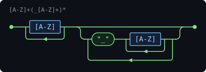
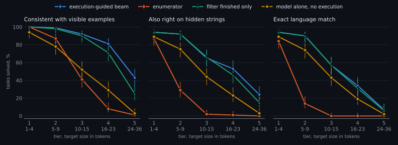
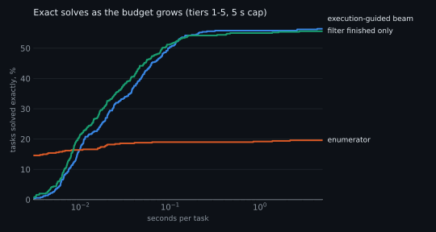
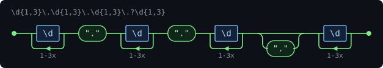
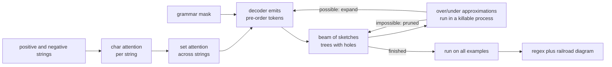

# regexsmith

[](https://github.com/matejpopovski/regexsmith/actions/workflows/ci.yml)

Give it strings that must match and strings that must not. A small transformer, written by hand in PyTorch, proposes regexes as syntax trees, and every candidate is executed against the examples, so the program knows when it has succeeded instead of hoping.

The file `examples/constant.txt` lists `MAX_SIZE`, `HTTP_PORT`, `DEBUG`, `X_Y` and four others as strings to accept, and `max_size`, `_LEADING`, `TRAILING_`, `DOUBLE__SCORE` and three others as strings to reject:

```console
$ regexsmith solve -f examples/constant.txt --svg docs/constant.svg
8 must match, 7 must not
beam width 16, 18 sketches pruned, 144 regex runs, 0 timeouts, 0.14 s
[A-Z]+(_[A-Z]+)*
  also passes: ([A-Z]\w?[A-Z]+)+
  also passes: ([A-Z]+_?[A-Z]{1,2})+
  also passes: ([A-Z][A-Z]?_?[A-Z]+)+

●─┬─[A-Z]─┬┬────────────────┬─●
  └───<───┘└┬─"_"─┬─[A-Z]─┬┬┘
            │     └───<───┘│
            └──────<───────┘
```



Those four regexes all pass every example. Only the first is what a person meant, and telling them apart is the real problem. On 500 held-out tasks at 5 seconds each, the share whose answer is **exactly the target language**, proved by a DFA equivalence check:

| | tier 1 (1-4 tokens) | tier 2 (5-9) | tier 3 (10-15) | tier 4 (16-23) | tier 5 (24-36) | 36 real-world formats |
|---|---|---|---|---|---|---|
| execution-guided beam | 94% | 89% | 57% | 33% | 7% | 50% |
| enumerator, same budget | 84% | 14% | 0% | 0% | 0% | 14% |

Tier 5 is a failure by any reasonable standard, and pruning adds far less to exactness than it was built to. Both are explained below.

## Results

Everything here comes from `results/`, produced by one trained model on an Apple M3 Max (36 GB). Each method gets the same 536 tasks and the same 5 seconds of wall clock per task: 100 per tier from a split whose target regexes were never trained on, plus a hand-written suite of 36 real-world formats that the generator is barred from producing.

An answer can pass at three levels, and the gap between them is the story:

- **Consistent**: right on the visible examples. Any search can get this by writing `pos1|pos2|pos3`, so it proves little alone.
- **Generalizes**: also right on up to 40 hidden strings, half of them near-misses.
- **Exact**: accepts precisely the target's language.

Exact, percent of tasks:

| method | tier 1 | tier 2 | tier 3 | tier 4 | tier 5 | field |
|---|---|---|---|---|---|---|
| model alone, no execution | 89.0 | 74.0 | 43.0 | 19.0 | 2.0 | 27.8 |
| filter finished only | 94.0 | 89.0 | 57.0 | 32.0 | 6.0 | 52.8 |
| execution-guided beam | 94.0 | 89.0 | 57.0 | 33.0 | 7.0 | 50.0 |
| enumerator | 84.0 | 14.0 | 0.0 | 0.0 | 0.0 | 13.9 |
| enumerator, 10x budget | 84.0 | 16.0 | 0.0 | 0.0 | 0.0 | 16.7 |

Generalizes:

| method | tier 1 | tier 2 | tier 3 | tier 4 | tier 5 | field |
|---|---|---|---|---|---|---|
| model alone, no execution | 89.0 | 75.0 | 44.0 | 23.0 | 3.0 | 33.3 |
| filter finished only | 94.0 | 91.0 | 66.0 | 47.0 | 13.0 | 69.4 |
| execution-guided beam | 94.0 | 91.0 | 65.0 | 52.0 | 24.0 | 69.4 |
| enumerator | 87.0 | 29.0 | 2.0 | 1.0 | 0.0 | 33.3 |
| enumerator, 10x budget | 87.0 | 33.0 | 2.0 | 1.0 | 0.0 | 44.4 |

Consistent:

| method | tier 1 | tier 2 | tier 3 | tier 4 | tier 5 | field |
|---|---|---|---|---|---|---|
| model alone, no execution | 94.0 | 78.0 | 52.0 | 29.0 | 3.0 | 38.9 |
| filter finished only | 100.0 | 97.0 | 90.0 | 72.0 | 22.0 | 83.3 |
| execution-guided beam | 100.0 | 98.0 | 90.0 | 80.0 | 44.0 | 88.9 |
| enumerator | 100.0 | 87.0 | 41.0 | 8.0 | 1.0 | 63.9 |
| enumerator, 10x budget | 100.0 | 97.0 | 62.0 | 16.0 | 4.0 | 86.1 |



Intervals on the chart are 95% Wilson intervals over tasks. There is one training seed, so they say nothing about variation between trained models.

**The model's prior does the heavy lifting, not the search.** The model alone, with nothing executed, is exact on 227 of the 500 generated tasks. Executing finished candidates raises that to 278. Executing partial programs as well raises it to 280. The pruning does exactly what it was designed to do and that turns out not to be what matters most.

**Pruning buys consistency, not exactness.** On tier 5, guided search finds a regex passing every example on 44 tasks against 22 without pruning, and in the paired counts it solves 22 tasks the filter misses while the filter solves none it misses. For generalizing, the gains at tiers 4 and 5 are real but smaller (52 vs 47, 24 vs 13). For exact, the paired difference over tiers 1-5 is 3 tasks to 1, too few to lean on, and on the field suite the filter is ahead by one task, `snake case`, where pruning reached a consistent but wrong regex at width 16 and stopped before the filter's width 32 pass found the right one. Pruning reaches *a* regex in a part of the space the beam would otherwise run out of slots for. Nothing in it knows which regex was meant.

**More time would not help.** Exact solves reach 51.0% of tiers 1-5 by 0.2 s, 55.2% by 1 s and only 56.0% by 5 s. Budget is not the limit for this model. The curve also shows where the enumerator is the right tool: inside 5 ms it solves 15.4% against 0.2%, because tier 1 tasks fall out of its first cost levels before the model has finished encoding.



**The enumerator overfits, as it should.** It returns a smallest consistent regex, so on the field suite it answers `(\d-*){8}` for ISO dates and `(/|\d{2}){6}` for US dates. Those pass the examples and are terrible regexes. It reaches consistency on 87% of tier 2 and exactness on 14%. Smallest is simply not the same as intended, and that gap is the reason to learn a prior at all.

To check that this is not an artifact of the enumerator being written in NumPy rather than C++, it also ran with ten times the budget:

The extra 45 seconds lifts consistency a lot (tier 3 from 41% to 62%, tier 4 from 8% to 16%) and exactness hardly at all (tier 2 from 14% to 16%, the field suite from 14% to 17%). More search finds more small regexes that fit the examples and are not the one intended. Six tasks are solved exactly by this version and not by guided search, and 198 the other way round.

The baseline is not a straw man. It enumerates candidates in token order over the same grammar as the model, with exact observational equivalence on the substrings of the examples, the characteristic-vector idea from [Valizadeh and Berger (PLDI 2023)](https://arxiv.org/abs/2305.18575). It manages a median of about 107,000 candidates per second on one core. The worst fair comparison for the transformer would be a GPU implementation of that paper, which this repository does not attempt.

### Failures

`results/failures.md` samples each kind, generated by `scripts/make_report.py`. Of the 238 tasks guided search did not solve exactly: 92 had no consistent regex in time, 93 passed the examples but failed hidden strings, and 53 passed every string tested yet are a different language. The last group is mostly near-identical: `[a-z]+=[a-z0-9]*` for `[a-z]+=[a-z0-9]+`, or `(...)+` where the target capped at `{1,3}` and the examples never showed the boundary.

Patterns worth naming:

- **Counting is learned as copying.** Given `Z([A-Z]Zq){2,4}` it writes `Z[A-Z]Zq[A-Z]Z[a-zA-Z]*q`. It unrolls the loop it sees rather than abstracting it, which passes the examples and fails on hidden strings.
- **Sketch execution has a cost.** `uuid` found nothing and took 26 regex timeouts on the way, because `.*` holes make sketches of long strings slow. Filter mode failed on it too, for the plainer reason that the beam ran out of time.
- **Word alternations are weak.** `[a-z]+@[a-z]+\.(com|org|net)` and `INFO|WARN|ERROR` failed, the second as `[A-Z]{4}R?`, which passes the examples and generalizes badly. Training literals are random letters, which probably explains it: nothing teaches that a word is a unit.
- **Hand-written examples are harder than sampled ones.** Of the seven files in `examples/` (outputs in `results/hand_written_examples.txt`), two get the regex a person would write, two get a wrong one, and three get nothing in 5 s, including `kebab.txt`, even though the near-identical `slug` is at least consistent on the field suite. `ipv4.txt` returns this, which passes all twelve examples:



The optional third dot is easy to miss in `\d{1,3}\.\d{1,3}\.\d{1,3}\.?\d{1,3}` and hard to miss in the diagram. That is why candidates are shown this way: passing the examples is necessary, and a person still has to look.

## How it works



The transformer is about 6 million parameters of hand-written attention, with no `nn.Transformer`. The encoder has no position information between strings, so example order cannot matter, and a test pins that down. The decoder also gets the kind of hole it is filling and the number of open holes, which exposes the tree that a flat token sequence hides.

Training used fresh tasks from a generator with a difficulty curriculum, 1.09 million of them in 8,500 steps and 39 minutes on MPS, with grammar-masked cross-entropy against one target regex. Teacher-forced whole-program accuracy on the training distribution ended at 83% on tier 1 and 5% on tier 4, well below the search results, which is what beam search and execution are for. The curves are in `results/training_metrics.jsonl`.

## Why this is hard, and what follows from it

The specification is a handful of strings, so the task is underdetermined by construction. The space is about 104 tokens to the power of program length. And the natural way to check a candidate can hang the process.

**Decode trees, not characters.** This is the decision everything else rests on. In a pre-order walk, any prefix is a tree with holes. Replace the holes with `.*` and you get a regex that contains every completion; replace them with the empty language and you get one contained in every completion. All regex operators are monotone, so if the first misses a positive, or the second hits a negative, the whole subtree can go. This is the pruning idea from [AlphaRegex (Lee, So and Oh, GPCE 2016)](https://prl.korea.ac.kr/papers/LeeSoOh16.pdf) applied inside a neural beam. A character-level decoder was rejected because `([a-z]+|` means nothing and cannot be bounded. The soundness is property-tested against thousands of random trees, and end to end: no prefix of a true solution is ever pruned.

**One token count everywhere.** Tiers are defined by target size in tokens, the enumerator's cost is size in tokens, and both search the same canonical grammar: right-nested chains, no quantifier directly on a quantifier. So a tier means the same thing to both methods, and the enumerator's reach can be read off directly.

**Execution needs a real timeout.** `re` cannot be interrupted from another thread. `signal.alarm` works only on the main thread and depends on the engine checking for signals. The third-party `regex` module has a timeout, but it is not the engine a Python user will run the result on. So patterns run in a separate stdlib-only process that the parent watches line by line and kills, resuming the batch after the hung query. Timeouts are not hypothetical. Over the benchmark, guided search hit 65 of them on 9 tasks, and `results/timeout_examples.json` keeps real patterns such as `s\d|([a-zA-Z]*s.*){12}`, the over-approximation of a sketch. A sketch that times out after 50 ms stays in the beam, since an unknown is not a refutation. A finished regex gets 250 ms and is rejected if it needs more, because a regex that hangs is not an answer. The first benchmark run used 250 ms for both and let a batch of slow patterns overrun the budget: one task took 10.5 s, and `uuid` spent its whole budget on timeouts. The executor now takes a deadline as well, and the published numbers are from the rerun.

**Grading cannot use the thing being graded.** Answers are graded with a Brzozowski derivative engine, which cannot backtrack, and exact equality is decided by Hopcroft-Karp over lazily built DFAs. When two regexes differ, it returns a witness string, and those appear in the failure report. Comparing on sampled strings was rejected because it cannot see the difference between `{1,3}` and `+`.

**Widen, do not guess a beam.** Search restarts at double the width until something passes or time runs out, with a verdict cache across passes. Most tasks end at width 16, and the median widest pass was 16 for both modes. A fixed wide beam would spend the whole budget on easy tasks.

**Decode on the CPU, train on the GPU.** MPS is built for large batches. One decoder step on one CPU thread ran 13 times faster than on MPS at beam width 1 and 6.6 times faster at 16, with the crossover near 256 (`results/decode_speed.json`, `scripts/bench_decode.py`). Most of the search happens at small widths, so evaluation ran the model on a single CPU thread, which also matches the single core the enumerator gets. Weights are stored as float16 to fit in 12 MB, and the reported results are from that exact file; its hash is in `results/summary.json`.

Per-example decoding in the style of RobustFill was rejected because it multiplies the work of each beam by up to 20 strings. Attending to every character of every example gives the decoder the same access, and it is why the memory is packed: most of the padded grid is empty.

### Things that went wrong on the way

The training data generator ran `re` on its own target regexes, and the workers hung, which stalled the whole `DataLoader` because it reads workers in order. A target like `(\d|[0-9a-f])+` on a 40-character near-miss does not return in any useful time, and it has no nested star, so the first guard missed it. The broader guard then missed ambiguous bodies under counted loops, such as a `{12}` around an alternation, and a run stalled at step 4,100 until the loader timeout fired. The offending regexes were not captured; those shapes come from reasoning about the matcher, and from a stress test running clean after the fix: 348,026 tasks from tiers 3-5 with the slowest at 0.22 s (`results/generator_stress.json`). Generation now sends such targets to the derivative matcher, and the run resumed from its checkpoint at step 4,000. It is the project's own premise turning up in the project's own tooling.

The run then used up its time budget and deadlocked inside Metal during the last checkpoint save, waiting on a command buffer that never completed. The shipped model is the checkpoint from step 8,500 of the 8,800 reached, at 39 minutes, where the learning rate had already decayed below 5e-6. Non-blocking copies into MPS were removed as the likely cause, though that was not proved. The schedule is driven by elapsed time for this reason: a shared GPU turned a planned 14,000 steps into 8,800, and the learning rate still finished its decay.

## Running it

Python 3.12 and [uv](https://docs.astral.sh/uv/). The checkpoint is in the repository, so a clean clone can solve tasks immediately.

```bash
uv venv --python 3.12 && uv sync --frozen
uv run --frozen pytest -q                                # 244 tests, about 30 s, tiny models on CPU
uv run --frozen regexsmith solve -f examples/ticket.txt
uv run --frozen regexsmith solve -p 2024-01-31 -p 1999-12-01 -n 24-01-31 -n 2024/01/31
uv run --frozen regexsmith draw '\d+(\.\d+)?' --svg out.svg
```

Example files use `+ ` and `- ` line prefixes. `--fallback` hands over to the enumerator if the neural search finds nothing.

Reproducing the results (the benchmark file is committed, and `regexsmith benchmark` regenerates it byte for byte):

```bash
uv run --frozen regexsmith train --run-dir runs/main --export checkpoints/regexsmith.pt   # MPS, 40 min
uv run --frozen regexsmith evaluate --out results                                         # about 1.5 hours
uv run --frozen --group report python scripts/make_report.py
uv run --frozen python scripts/catch_timeouts.py
uv run --frozen python scripts/bench_decode.py
uv run --frozen python scripts/stress_generator.py
./scripts/run_examples.sh
```

For the published numbers, methods ran as parallel processes with `--methods` and were combined with `regexsmith merge`: the model alone and the 5 s enumerator in one session, filter and guided search in a later one alongside the 10x enumerator. Budgets are wall clock, and the machine was shared with unrelated jobs: `uptime` reported load averages between 20 and 50 on 14 cores throughout. That makes the timing pessimistic for every method, and a repeat will not match to the task.

## Limitations

- **Same distribution for training and tiers.** Tiers 1-5 use the training generator with unseen targets, so they flatter the model. The field suite is the fairer number at 50% exact, and even there the examples are sampled from the regex rather than written by a person. The seven hand-written files in `examples/` are too few for a rate, and two out of seven is the number to keep in mind.
- **Tier 1 has repeats.** The held-out split of tier 1 is small, so those 100 tasks cover 62 distinct targets. Tiers 2-5 and the field suite have no duplicates.
- **One model, one seed.** The confidence intervals cover task sampling only.
- **Exact is a strict grade for some tasks.** With 10 positives, `\w` and `[a-zA-Z0-9]` can be indistinguishable, and such an answer counts as a miss even if a person would accept it.
- **Syntax subset.** Printable ASCII, up to 40 characters per example, regexes up to 48 tokens, sixteen fixed quantifiers, nine classes, and no anchors, backreferences, lookaround or negated sets. Matching is always `fullmatch`.
- **Timeouts on a loaded machine can misfire.** A false timeout on a sketch is harmless. On a finished regex it rejects a valid answer. Filter mode, which only runs finished regexes, hit one timeout across the benchmark.
- **The budget is enforced per search depth and per regex batch.** No answer found after the deadline is accepted, but 3 of the 1,072 neural search runs took more than 5.2 s to notice, the longest 7.1 s.
- **The enumerator is NumPy on one core.** A compiled or GPU version would reach further; the ten-times row indicates how much that buys, not a bound.
- **The benchmark was not untouched.** Search settings were checked on tasks from the training split and no model selection took place, but a 25-task dry run of the pipeline used the benchmark file with a partly trained model, and the timeout fix described above came from reading the first full run. That fix changed how a budget is spent, not any model.

## Layout

```
src/regexsmith/
  dsl.py          trees, tokens, rendering, parsing, sketch approximations
  grammar.py      legal-token masks and the decoding stack machine
  semantics.py    derivatives, language equivalence, backtracking risk
  executor.py     regex execution with a hard timeout (_regex_worker.py is the child)
  baseline.py     bottom-up enumerator on characteristic vectors
  tasks.py        task generator, tiers, near-miss negatives
  field.py        the 36 real-world formats
  model.py        the transformer
  data.py, train.py
  search.py       beam search in its three modes
  evaluate.py     benchmark harness and grading
  railroad.py     terminal and SVG diagrams
```

MIT licensed. Execution-guided synthesis as a general idea appears in [Chen, Liu and Song (ICLR 2019)](https://iclr.cc/virtual/2019/poster/760).
